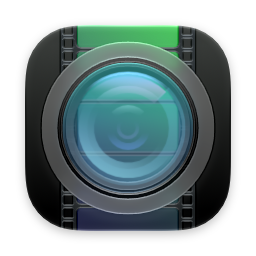
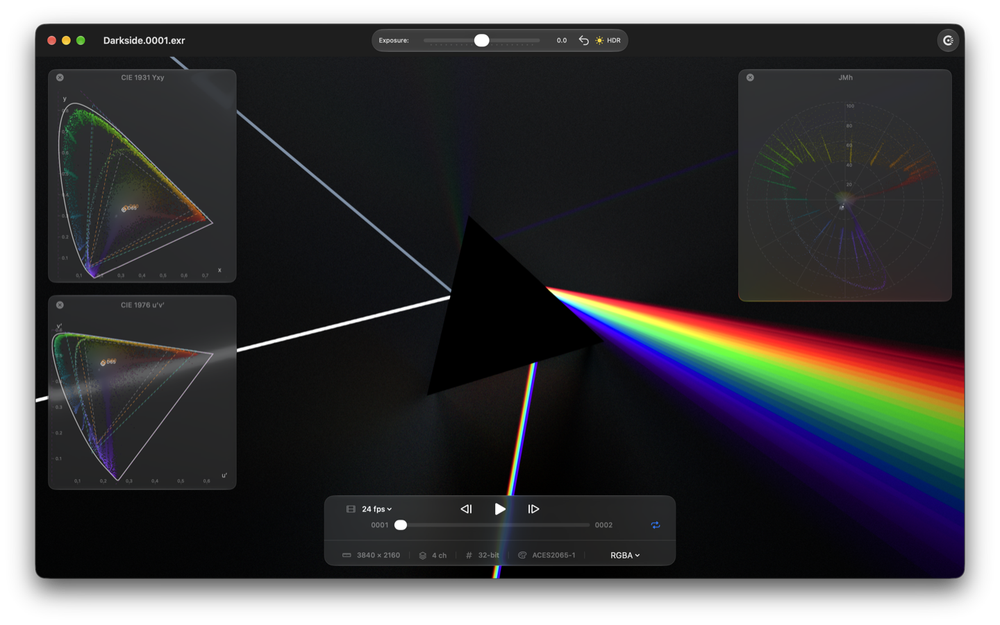
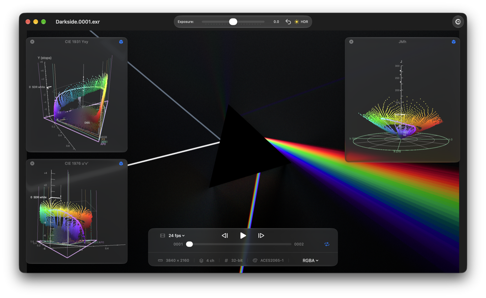

<p align="center">
  
</p>

<h1 align="center">Tristimulator</h1>

<p align="center">
  An idiomatically correct native Mac viewer for OpenEXR and other formats, with OpenColorIO colour management, dynamic ACES 2 rendering, and EDR integration.
</p>

<p align="center">
  
</p>

## Features

- Opens OpenEXR, including multilayer files, plus DPX, Cineon, Radiance HDR, TIFF, PNG, JPEG, HEIC, JPEG XL and more through OpenImageIO.
- Plays Image Sequences, QuickTimes and MPEG-4 movies, with frame stepping, scrubbing and looping. Realtime EXR playback with modern SSDs.
- Each window has its own OpenColorIO pipeline: config, source colour space, working space, display and view. Open a second window on the same file to compare two pipelines side by side.
- ACES 2.0 display rendering with limiting primaries and peak nits. The peak can follow the display's current EDR headroom.
- Python scripting interface for studio specific OCIO workflows. 
- ACES Metadata File (AMF) support. A matching `.amf` next to the image is found automatically, or you can load one yourself.
- Shows extended dynamic range on displays that support it. The toolbar reports HDR or SDR for the current display, with EDR details and a peak measurement of the image on screen.
- Exposure from -10 to +10 stops, and single-channel views for red, green, blue, alpha and luminance.
- CIE 1931 Yxy, CIE 1976 u'v' and JMh chromaticity diagrams drawn over the image, each in 2D or 3D. The 3D scopes plot every pixel as a point cloud, with luminance in stops for Yxy and u'v' and J for JMh. Drag to orbit, Option-drag or right-drag to pan, scroll to zoom and double-click to reset the view. Scope windows can be moved and resized, and the 3D view fills the scope's shape.
- Scope layout, 2D/3D mode, the 3D camera and the JMh M range are remembered between launches.
- Each image remembers its window size and position, and reopens where you left it.
- Optionally opens display-referred images in Inverse Display mode. A newly opened image tagged with an SDR display colour space, such as sRGB - Display or Display P3 - Display, starts by inverting that display's SDR view (ACES 2.0 SDR 100 nits where available). Turn it on in Settings > OCIO > Display-Referred Images.
- Copy or export an image with its OpenColorIO processing as an HDR gain-map HEIC or JPEG, with an UltraHDR option for JPEG.
- A Quick Look extension that previews OpenEXR files in the Finder, with Dynamic ACES 2.0 rendering following availible EDR headroom..

<p align="center">
  
</p>

## What's new in 0.1.1

- 3D Yxy, u'v' and JMh scopes, with orbit, pan, zoom and reset.
- Scope settings and each image's window size and position are restored.
- Optional inverse display transform for display-referred images.
- Fixed a crash after waking the Mac with Dynamic ACES 2 auto-nits on, caused by overlapping OCIO GPU pipeline compiles.

The help book in `Help/Tristimulator.help` lists the supported file types and keyboard shortcuts.

## Requirements

- A Mac with Apple silicon. Intel Macs are not supported.
- macOS 15 Sequoia or later.
- The Quick Look extension needs macOS 26.4 or later.

## Install

Signed and notarised DMGs are on the [Releases](https://github.com/alexfry/Tristimulator/releases) page. Download the DMG from the latest release, open it, and move Tristimulator to your Applications folder.

Quick Look: put Tristimulator in your Applications folder and open it once so macOS registers the extension. If previews do not appear, check that the extension is turned on in System Settings > General > Login Items & Extensions > Quick Look. The extension previews OpenEXR files only.

## Building from source

You need an Apple silicon Mac and Xcode 27.2 (CI selects `/Applications/Xcode_27.2.app`). The Quick Look extension targets macOS 26.4, so the SDK must be 26.4 or newer, and the app icon was authored in Xcode 27.

1. Build the third-party libraries. `Scripts/build_thirdparty.sh` uses vcpkg to build OpenColorIO, OpenImageIO, OpenEXR, Imath and their dependencies as static libraries for arm64. The first run can take 30 to 60 minutes. Later runs with an unchanged manifest are a cache hit.

   ```sh
   Scripts/build_thirdparty.sh
   ```

   The libraries are installed under `~/Library/Caches/Tristimulator/ThirdParty` (override with `THIRDPARTY_ROOT`). The script also writes `Generated/ThirdParty.generated.xcconfig` with the link flags.

2. Build and test. `Scripts/ci_xcode_test.sh` runs the same debug build and tests as CI, with an ad-hoc signature:

   ```sh
   Scripts/ci_xcode_test.sh
   ```

   It runs `xcodebuild test` for the `Tristimulator` scheme with the destination `platform=macOS,arch=arm64`.

The Xcode project still has header and library search paths under `/Users/alex/Library/Caches/Tristimulator/`. If your account is not named `alex`, make that path point at your cache directory, for example with a symlink, before building in Xcode. CI does this in `Scripts/ci_prepare_runner.sh`. See [docs/CI.md](docs/CI.md) for more on the build, the release workflow and its signing secrets.

## Licence

Tristimulator is released under the [MIT licence](LICENSE). Third-party libraries and data keep their own licences. Their notices are in [ThirdPartyNotices](ThirdPartyNotices/README.md).

## Author

Made by Alex Fry.

OpenEXR, OpenColorIO, OpenImageIO and ACES are projects of their respective owners.
